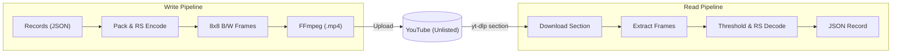

# Youtube-as-a-Database

> ⚠️ **Educational joke project. Do not store real or personal data on YouTube.** Use fake data only.


**A database that stores its rows as TV static on YouTube.**

StaticDB encodes bytes into black-and-white video frames (with Reed-Solomon error correction so the data survives YouTube's compression), uploads them as an unlisted video, and reads individual records back by downloading only the few seconds of video that contain them.

It is slow by design. That's the joke.

---

## How it works



1. **Pack:** Each customer is a fixed-size 512-byte JSON record, so `byte_offset = n * 512`.
2. **Encode:** Bytes get Reed-Solomon parity, then each bit becomes an 8×8 black or white block (240×135 grid per 1080p frame, about 4 KB per frame).
3. **Render:** Frames are piped into FFmpeg (`libx264`, 1080p, 30 fps).
4. **Index:** A small SQLite table maps record IDs to a video ID and byte offset.
5. **Read:** `yt-dlp --download-sections` fetches only the needed seconds, OpenCV extracts frames, and the codec decodes them back to bytes.
6. **Write:** YouTube videos are immutable, so updates are **append-only**: new data goes into a new video and the index pointer moves.

---

## Project layout

```
youtube-as-a-database/
├── docs/           # Architecture, encoding science, API spec, and guides
├── codec.py        # bytes <-> frames (8x8 blocks, Reed-Solomon, per-frame CRC)
├── video.py        # frames <-> mp4 via FFmpeg
├── store.py        # append-only writer + SQLite index
├── reader.py       # section download + decode one record
├── api.py          # FastAPI: GET /customer/{id}
├── seed.py         # generates 1,000 fake customers
├── static/
│   └── index.html  # UI with a very honest loading spinner
├── schema.sql      # SQLite index schema DDL
├── requirements.txt
└── README.md
```

---

## Quick start

### Prerequisites

- Python 3.10+
- [FFmpeg](https://ffmpeg.org/download.html) on your `PATH`
- A **throwaway** YouTube channel

### Install

```bash
git clone https://github.com/toxicbishop/youtube-as-a-database.git
cd youtube-as-a-database
python -m venv .venv && source .venv/bin/activate
pip install -r requirements.txt
```

`requirements.txt`:

```
numpy
opencv-python
reedsolo
yt-dlp
fastapi
uvicorn
cryptography
```

### Run

```bash
# 1. Generate 1,000 fake customers and encode them into a video
python seed.py

# 2. Upload the generated video to YouTube as Unlisted (manually via YouTube Studio)
#    then register its ID:
python store.py register --video-id <YOUTUBE_VIDEO_ID>

# 3. Start the API
uvicorn api:app --reload
```

Open `http://localhost:8000` or query directly:

```bash
curl http://localhost:8000/customer/402
```

---

## API

| Method | Endpoint | Description |
|--------|----------|-------------|
| `GET`  | `/customer/{id}` | Fetch a record (expect 5 to 10 seconds) |
| `PUT`  | `/customer/{id}` | Queue an update (applied on next flush) |
| `POST` | `/flush` | Encode pending updates into a new video and repoint the index |

---

## Benchmarks

| Operation | SQLite | StaticDB |
|-----------|--------|----------|
| Read one record | ~2 ms | ~5,000 to 10,000 ms |
| Update one record | ~2 ms | "eventual consistency (hours)" |
| Storage cost | disk | someone else's servers |
| Vibes | boring | immaculate |

---

## Design notes

- **Why 8×8 blocks?** YouTube re-encodes everything. Single-pixel bits get destroyed by compression, while larger blocks survive. If errors persist, bump to 16×16.
- **Why Reed-Solomon?** Compression still flips some bits. RS(32) repairs them.
- **Why append-only?** Uploaded videos can't be edited.
- **Why a local index?** Without it you'd have to download and scan the whole video for every query.

---

## Roadmap

- [x] Concept
- [x] `codec.py` with local round-trip test
- [x] Simulated compression test (re-encode at lower quality and resolution)
- [x] SQLite index and segment reads
- [x] FastAPI and UI
- [x] Update and flush flow
- [ ] Verify the `yt-dlp` section download against a real YouTube upload (the code exists, but it has only been tested through the local path)
- [ ] Demo recording next to a 2 ms SQLite query
---

## Disclaimer

This is a proof-of-concept and a joke. Storing arbitrary data on YouTube may violate its [Terms of Service](https://www.youtube.com/t/terms) and can get accounts banned. Never store real, personal, or sensitive data (customer records, credentials, anything covered by GDPR or similar laws) with this project. Use generated fake data only.

Inspired by the open-source *Infinite-Storage-Glitch* experiment.

## License

MIT
