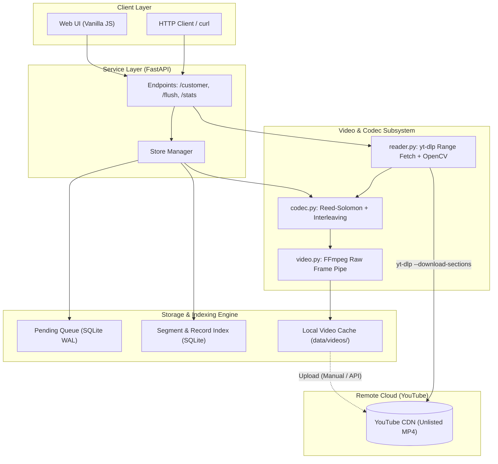

# YouTubeDB System Architecture

## 1. Overview

YouTubeDB turns YouTube into a remote, append-only, relational/KV database. It overcomes the two biggest limitations of prior art (*Wild-Storage*, *Infinite-Storage-Glitch*):
1. **No Monolithic Downloads:** Queries use sub-second HTTP range seeks (`yt-dlp --download-sections`) to retrieve specific rows in 5–10s without downloading entire video files.
2. **Lossless Error Resilience:** Uses byte-interleaved Reed-Solomon error correction and temporal frame repetition to ensure zero data loss under YouTube's lossy re-encoding pipeline.

---

## 2. System Architecture

---

## 3. The Pipelines

### 3.1 Write Pipeline (Flush / Ingestion)

```mermaid
flowchart LR
    R["Raw Records (JSON)"] --> P["Fixed-Size Pack (512B)"]
    P --> RS["Reed-Solomon Encode (GF(256))"]
    RS --> IL["Byte Interleaving"]
    IL --> BLK["Rasterize to 8x8 Blocks"]
    BLK --> REP["Temporal Repetition (3x Duplicate Frames)"]
    REP --> FFMPEG["FFmpeg Pipe (libx264, 1080p, 30fps)"]
    FFMPEG --> MP4[".mp4 Video Segment"]
    MP4 --> IDX["Update SQLite Index"]
```

1. **Packing:** Records are formatted as `[2-byte length][JSON body][zero-padding]` up to exactly 512 bytes.
2. **ECC & Interleaving:** 15 Reed-Solomon codewords ($N=255, K=223$) are generated per frame and byte-interleaved to distribute localized video compression artifacts.
3. **Rendering:** Each bit is drawn as an $8 \times 8$ black (`#000000`) or white (`#FFFFFF`) pixel block on a $1920 \times 1080$ raster.
4. **Temporal Hold:** Each unique frame is duplicated $3\times$ consecutively. This collapses P/B-frame bitrates in YouTube's encoder, avoiding compression smearing.
5. **Video Assembly:** Raw frames are piped into FFmpeg via `stdin` and encoded with `libx264`.

---

### 3.2 Read Pipeline (Point Lookups)

```mermaid
flowchart LR
    ID["Query: customer/{id}"] --> LOC["Lookup Index (video_id, byte_offset)"]
    LOC --> TIME["Compute Time Range (start, end seconds)"]
    TIME --> YTDL["yt-dlp --download-sections"]
    YTDL --> CV["OpenCV Frame Extraction"]
    CV --> DEDUP["Frame Deduplication & CRC Verify"]
    DEDUP --> RSDEC["Reed-Solomon Error Correction"]
    RSDEC --> UNPACK["Unpack 512B Record -> JSON"]
```

1. **Offset Lookup:** The local SQLite index identifies which video segment contains the target record and its byte offset.
2. **Timestamp Translation:** Converts byte offset to frame index:
   $$\text{frame} = \left\lfloor \frac{\text{byte\_offset}}{\text{payload\_per\_frame}} \right\rfloor$$
   $$\text{timestamp} = \frac{\text{frame} \times \text{repeat}}{\text{fps}}$$
3. **Range Download:** `yt-dlp` fetches only $[\text{timestamp} - \text{pad}, \text{timestamp} + \text{duration} + \text{pad}]$ from YouTube.
4. **Decoding:** OpenCV thresholds blocks against luminance 128, reassembles codewords, repairs flipped bits via Reed-Solomon, checks CRC32, and extracts the JSON string.

---

## 4. Component Directory

- **`codec.py`**: Pure math and rasterization. Handles GF(256) Reed-Solomon encoding, 2D byte interleaving, CRC32 headers, and binary image thresholding.
- **`video.py`**: Interprocess bridge between Python memory buffers and FFmpeg subprocesses via stdin/stdout pipes (no temporary image files written to disk).
- **`store.py`**: Append-only transaction manager. Controls local segment writing, YouTube ID registration, and SQLite index synchronization.
- **`reader.py`**: Partial range downloader and recovery coordinator using `yt-dlp` and OpenCV.
- **`api.py`**: Asynchronous REST API built on FastAPI providing endpoints for querying, staging updates, and flushing segments.
- **`static/index.html`**: Web user interface with real-time TV static visualization and transparent query latency reporting.
