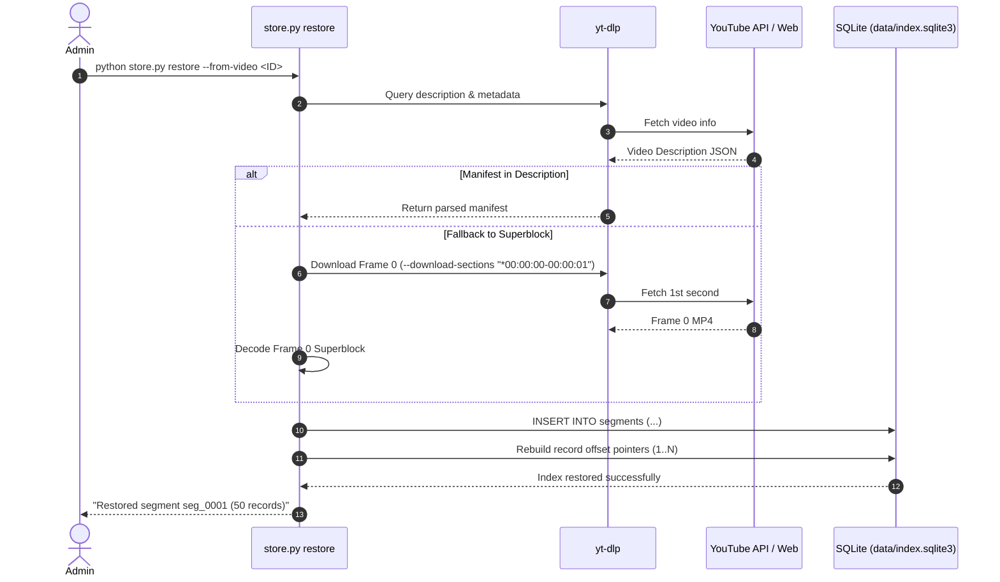

# Metadata Architecture & Disaster Recovery

## 1. The Zero-Local-State Philosophy

A primary weakness of early YouTube storage experiments was reliance on local state. If the local machine crashed or the SQLite index was lost, the videos on YouTube became unusable because no one knew which video contained which record.

YouTubeDB implements a **dual-layer self-reconstructing metadata architecture**:
1. **YouTube Video Description Manifest:** Plaintext JSON embedded directly in YouTube's metadata.
2. **Superblock (Frame 0):** The first frame of every video segment encodes the full segment manifest as binary data.

---

## 2. YouTube Video Description Manifest

When a segment video is rendered and uploaded, the system generates a compact JSON manifest designed to be pasted into the video description on YouTube:

```json
{
  "youtubedb": "v1",
  "segment": "seg_0001",
  "created_at": 1795326902.82,
  "record_range": [1, 50],
  "record_count": 50,
  "record_size": 512,
  "frames": 8,
  "fps": 30,
  "repeat": 3,
  "geom": {
    "width": 1920,
    "height": 1080,
    "block": 8,
    "nsym": 32
  }
}
```

### Advantages:
- **Instant Discovery:** `yt-dlp --dump-json <URL>` extracts the video description in $<1\text{ second}$ without downloading video media.
- **Playlist Scanning:** Pointing the recovery tool at a YouTube Playlist or Channel URL will index all segments in seconds.

---

## 3. Video Superblock (Frame 0)

To guard against video descriptions being truncated or edited, every video segment reserves **Frame 0 as a Superblock**.

```
┌─────────────────────────────────────────────────────────────┐
│                    Frame 0: Superblock                      │
├─────────────────┬──────────────┬────────────────────────────┤
│ Magic: "YTDBSB" │ Version: 0x01│ Manifest JSON (compressed) │
│ (6 bytes)       │ (1 byte)     │ (zlib deflated payload)    │
└─────────────────┴──────────────┴────────────────────────────┘
```

If the video description is lost or unavailable, `store.py restore` downloads only the first second of the video, decodes Frame 0, and reconstructs the metadata.

---

## 4. Disaster Recovery Procedure

To rebuild the SQLite index from scratch on a new machine:

### Method A: Restore from a Single Video
```bash
python store.py restore --from-video <YOUTUBE_VIDEO_ID>
```

### Method B: Restore an Entire Channel or Playlist
```bash
python store.py restore --from-playlist <PLAYLIST_ID>
```

### Execution Flow:


---

## 5. Append-Only Segment Lifecycle

YouTube videos are immutable. Once uploaded, a video cannot be modified.

1. **New Records & Updates:**
   - When a `PUT /customer/{id}` request is received, the update is queued in the local `pending` SQLite table (Write-Ahead Log).
   - Read requests continue serving the existing video segment pointer.
2. **Flushing (`POST /flush`):**
   - All pending updates are collected.
   - A new segment video (`seg_0002.mp4`) is rendered containing the updated records.
   - Once uploaded and registered, the `records` table repoints the affected IDs to `seg_0002`.
   - The previous segment (`seg_0001`) remains untouched as historical data.
